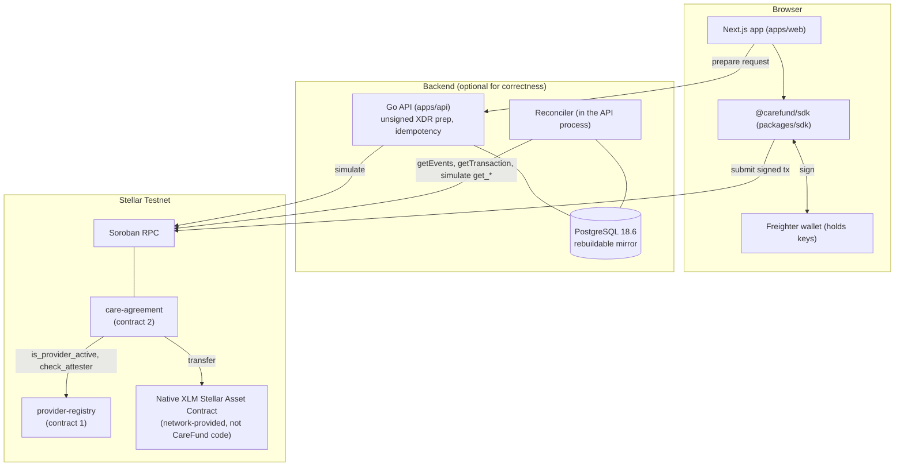
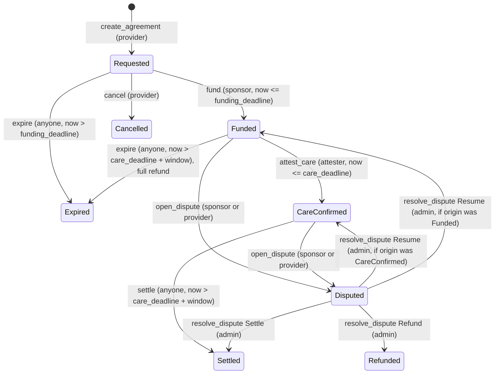

# CareFund Architecture

This document describes the system as implemented at the commit it was written against. It does not describe planned features. Where a statement is a design judgment or inference rather than something the code or evidence shows, it says so.

Every function and state name below was checked against `contracts/care-agreement/src/lib.rs` and `contracts/provider-registry/src/lib.rs`. Line references are to those files at this commit.

Related documents:

- [README.md](./README.md): project summary and proof at a glance.
- [docs-site/src/architecture.md](./docs-site/src/architecture.md): the shorter mdBook architecture chapter.
- [docs/trust-and-security-evidence.md](./docs/trust-and-security-evidence.md): trust assumptions, privileges and the security evidence matrix.
- [docs/differentiation.md](./docs/differentiation.md): comparison with other Stellar escrow projects.
- [docs/financial-behavior-specification.md](./docs/financial-behavior-specification.md): the adopted financial specification.
- [evidence/index.md](./evidence/index.md): the evidence ledger.

## 1. Purpose and goals

CareFund coordinates a conditional payment for a specific piece of care. A sponsor locks funds in a contract. A provider is paid a capped amount only if an authorized attester records a confirmation by a deadline and a dispute window then passes. If a funded agreement is never attested and is not disputed, then once the deadlines pass anyone can call `expire`, and the sponsor is refunded when that transaction executes. If a dispute is opened, the agreement stays `Disputed` until the administrator resolves it; there is currently no dispute timeout, so not every agreement reaches a terminal state without administrator involvement.

Design goals, in priority order:

1. Funds can only move to one of three places: the agreed provider, the agreed sponsor, or (for an unfunded agreement) nowhere. No code path sends escrow to a third address.
2. Every agreement ends in a terminal state without relying on any particular off-chain service being available.
3. Neither the API nor the web server ever holds a signing key.
4. Patient and service details are never submitted in plaintext.

Non-goals: CareFund is not insurance, a medical records system, an identity system, or a clinical verification service. It cannot establish that treatment happened (see section 12).

## 2. Components



| Component | Path | Responsibility |
|---|---|---|
| provider-registry | `contracts/provider-registry` | Admin-controlled set of providers and provider-bound attesters, with `Active`, `Suspended` and `Revoked` status. |
| care-agreement | `contracts/care-agreement` | Agreement records, state machine, escrow accounting, deadlines and transfers. |
| Native XLM SAC | Network-provided; `CDLZFC3S...GCYSC` on Testnet | The token contract that actually holds and moves XLM. CareFund calls its `transfer`. It is not CareFund code. |
| Go API | `apps/api` | Builds and simulates unsigned transactions, stores intents and idempotency keys, mirrors chain state into PostgreSQL. |
| Reconciler | `apps/api/internal/reconcile` | Runs inside the API process. Polls transaction status and contract events and upserts chain state. |
| SDK | `packages/sdk`, `packages/types` | Transaction building, simulation, Freighter signing, submission, bounded polling. |
| Web | `apps/web` | Provider, sponsor and attester screens. Client-side signing only. |

Only two contracts are CareFund-owned. The settlement asset contract is a third contract the care-agreement contract calls, and CareFund does not control it.

## 3. Why Stellar and Soroban

Stated plainly, the properties CareFund uses and where each shows up in the code:

- **`Address::require_auth`**: every role check is a signature check by the named address (for example `fund` at `care-agreement/src/lib.rs:495`, `attest_care` at `:715`). There is no password, session or API key on the authorization path.
- **A built-in token interface (SAC)**: native XLM can be escrowed with `transfer` calls and no CareFund token code. The contract holds balances at its own contract address.
- **Atomic multi-call transactions**: the provider payment and the sponsor surplus refund in `settle` happen in one transaction or not at all.
- **Ledger timestamps**: deadlines use `env.ledger().timestamp()`, which every validator agrees on.
- **Cross-contract calls**: agreement creation and funding query the registry on-chain rather than trusting caller-supplied status.
- **Public, permanent transaction records**: each step has a hash anyone can look up.

This is an argument that a ledger with programmable escrow is useful here, not that only Stellar can do it. Other smart-contract chains offer similar properties. The Stellar-specific choice reflects the ecosystem, low fees and native asset support; it is not proven necessary.

## 4. Roles and responsibilities

| Role | Who | What the contracts let them do |
|---|---|---|
| Admin | One address set at `initialize`, stored separately in each contract | Registry: register, suspend, reinstate and revoke providers and attesters. Agreement contract: `resolve_dispute`. No other power. |
| Provider | Registered address | `create_agreement`, `cancel` (only while `Requested`), `open_dispute`. Receives `settlement_amount` on settlement. |
| Sponsor | Any address named in an agreement | `fund` (only that agreement, only by that address), `open_dispute`. Receives surplus and refunds. |
| Attester | Address registered in the registry and bound to one provider | `attest_care` on agreements that name it. |
| Anyone | Any account | `settle` and `expire` once their time conditions hold; all read functions. |

The registry admin and the agreement admin are set independently at each contract's `initialize`. Nothing in the code forces them to be the same address. On Testnet both were initialized with the one `carefund-admin` identity, and `get_admin()` was read back on the agreement contract ([evidence/testnet-2026-10-09-block3b.md](./evidence/testnet-2026-10-09-block3b.md), section 4).

## 5. Admin and upgrade surface

What the admin can do, exhaustively, from the code:

- Provider registry: `register_provider`, `suspend_provider`, `reinstate_provider`, `revoke_provider`, `register_attester`, `suspend_attester`, `reinstate_attester`, `revoke_attester`.
- Care agreement: `resolve_dispute` (only on a `Disputed` agreement) with one of three outcomes:
  - `Resume`: return to the state the dispute came from.
  - `Settle`: pay the provider `settlement_amount` and the sponsor the surplus.
  - `Refund`: pay the sponsor the full `funding_amount`.

What the admin cannot do, because no function exists:

- Pick a destination address. Transfers go only to `agreement.provider` or `agreement.sponsor`, both fixed at creation.
- Pick an amount. Amounts are `settlement_amount`, the surplus, or `funding_amount`, all fixed at creation.
- Touch an agreement that is not `Disputed`.
- Sweep contract balances or withdraw stray tokens.
- Upgrade contract code. Neither contract calls `update_current_contract_wasm` (verified by search).
- Change the admin address alone. Rotation needs a second signature (below).

### Admin rotation

Both contracts have `transfer_admin(new_admin)`. It requires authorization from the current admin and from `new_admin` in the same call, so a role cannot be pushed onto an address that has not agreed to hold it. It replaces the value under the existing admin storage key atomically, emits an `adm_rot` event carrying the old and new addresses, and touches nothing else: no agreement, registry record, balance or dispute state is read or changed, and it creates no path for moving escrow. Calling it with the current admin as `new_admin` is an authorized no-op. After a rotation the previous admin fails every admin-only call, including `resolve_dispute` and the registry's provider and attester management.

The two contracts keep separate admins, so rotating one does not change the other.

Rotation is a handover tool, not recovery. It needs the current admin's signature, so it cannot help once that key is lost. See section 14 and [docs/dispute-recovery-proposal.md](./docs/dispute-recovery-proposal.md). `transfer_admin` is in the source and tested locally only. It is not in the deployed Testnet contracts (care_agreement WASM `b543e9a7...`, provider_registry WASM `30924b09...`), which have no admin rotation, so the deployed admins cannot use it.

## 6. Agreement state machine

States (`AgreementState`, `care-agreement/src/lib.rs:37`): `Requested`, `Funded`, `CareConfirmed`, `Disputed`, `Cancelled`, `Expired`, `Refunded`, `Settled`.



Terminal states: `Cancelled`, `Expired`, `Refunded`, `Settled`.

### The three deadlines

```
create ──── funding_deadline ──── care_deadline ──── care_deadline + dispute_window_secs ────►
   fund() allowed      attest_care() allowed      open_dispute() allowed        settle() / expire()
   (now <= fd)         (now <= cd)                (cd < now <= cd + window)     (now > cd + window)
```

Boundaries, taken from the code:

- `fund` fails when `now > funding_deadline` (`lib.rs:517`). `expire` on `Requested` fails when `now <= funding_deadline` (`:641`). At exactly the deadline funding is allowed and expiry is not.
- `attest_care` fails when `now > care_deadline` (`:737`).
- `open_dispute` requires `care_deadline < now <= care_deadline + dispute_window_secs` (`:820-825`).
- `settle` and `expire` (on `Funded`) require `now > care_deadline + dispute_window_secs` (`:655`, `:886`).

**The dispute window starts at `care_deadline`, not at attestation.** An attestation made well before the care deadline does not start any clock. Disputes cannot be opened before `care_deadline`, and settlement cannot happen before `care_deadline + dispute_window_secs`, whenever the attestation was made. The attestation timestamp (`attested_at`) is recorded but not used in any timing check.

Because dispute is allowed through `care_deadline + window` inclusive and settlement only after it, the two windows do not overlap. There is no instant at which both are valid.

## 7. Flows

### Funding (`fund`, `lib.rs:494`)

1. Sponsor signs. Agreement must be `Requested` and the signer must equal `agreement.sponsor`.
2. `now <= funding_deadline`.
3. Registry call `is_provider_active(provider)` must return true. The attester is not rechecked here.
4. `transfer(sponsor, this_contract, funding_amount)` on the settlement asset. If the sponsor lacks funds the call traps and the whole transaction reverts.
5. State becomes `Funded`.

### Attestation (`attest_care`, `:709`)

Agreement must be `Funded`, signer must equal `agreement.attester`, and `now <= care_deadline`. It stores the 32-byte `attestation_commitment`, the attester address and the timestamp, and moves to `CareConfirmed`. It moves no funds. Before recording, it reads the attester's current record from the registry (`get_attester`) and requires status `Active` and a binding to `agreement.provider`; otherwise it returns `AttesterNotAuthorized` and changes nothing. It does not require the provider to be `Active`, so suspending a provider alone does not stop a funded agreement from being attested. If the registry call fails or the record cannot be decoded, the attestation is rejected. This attestation-time check is in the source but not in the current Testnet deployment (care_agreement WASM `b543e9a7...`), which predates it. It has been tested locally only and is not `VERIFIED LIVE`.

| Operation | Registry check |
|---|---|
| `create_agreement` | Provider `Active`; attester `Active` and bound to the provider (`check_attester`) |
| `fund` | Provider `Active` |
| `attest_care` | Attester `Active` and bound to the agreement's provider, read at call time (provider status not checked) |
| Accepted attestation (`CareConfirmed`) | Not rechecked. A later suspension or revocation does not change a recorded attestation |
| `settle`, `expire`, `open_dispute`, `resolve_dispute` | No registry call |

Suspending or revoking an attester therefore stops new attestations but does not rewrite an attestation already accepted. Suspension is reversible: a reinstated attester can attest again before the care deadline. Revocation is terminal.

### Settlement (`settle`, `:862`)

Callable by anyone, no signature required. Requires `CareConfirmed` and `now > care_deadline + dispute_window_secs`. Transfers `settlement_amount` to the provider, then `funding_amount - settlement_amount` (checked subtraction) to the sponsor if positive, then sets `Settled`. A second call fails with `InvalidState`.

### Expiry (`expire`, `:628`)

Callable by anyone.

- `Requested` and `now > funding_deadline`: becomes `Expired`, no transfer.
- `Funded` and `now > care_deadline + dispute_window_secs`: refunds the full `funding_amount` to the sponsor and becomes `Expired`.
- `CareConfirmed` or any other state: `InvalidState`. Attested care cannot be expired.

### Dispute (`open_dispute`, `:786`, and `resolve_dispute`, `:956`)

The sponsor or the provider can open a dispute on a `Funded` or `CareConfirmed` agreement inside the window. The origin state is stored. Only the admin can resolve it, as described in section 5. There is **no timeout**: a `Disputed` agreement stays `Disputed` until the admin acts. Neither `settle` nor `expire` accepts a `Disputed` agreement.

Either party can freeze a `CareConfirmed` agreement by disputing inside the window. Permissionless settlement is therefore guaranteed only when neither the sponsor nor the provider disputes.

### Cancel (`cancel`, `:583`)

Provider only, only in `Requested`. No funds have moved.

### Refund summary

| Situation | Refund | Path |
|---|---|---|
| Never funded | none needed | `expire` or `cancel` |
| Funded, never attested, window passed | full `funding_amount` to sponsor | `expire` |
| Settled | surplus `funding_amount - settlement_amount` to sponsor | `settle` |
| Disputed, admin chooses `Refund` | full `funding_amount` to sponsor | `resolve_dispute` |

## 8. Financial invariants

For an agreement with funding amount `F` and settlement amount `S`:

- Creation requires `0 < S <= F` (`lib.rs:367-372`).
- Creation rejects `care_deadline + dispute_window_secs` overflow (`:389`), so later deadline arithmetic cannot trap.
- Every terminal path moves exactly `F` out of the contract for that agreement: `S` plus `F - S` on settlement, `F` on refund or funded expiry. Unfunded paths move nothing.
- The per-agreement accounting uses the stored `funding_amount` and `settlement_amount`, never the contract's token balance. One agreement cannot draw on another's deposit through the contract logic. This was exercised live with agreements 3 and 4 funded at once (Testnet evidence, Case 5).
- The contract holds a pooled balance. Anyone can send tokens directly to a contract address, so the balance can exceed the sum of open escrows. The contract has no sweep function, so such stray tokens are unrecoverable. The claim "balance returns to zero when all agreements finalize" holds only if nobody sends tokens to the contract directly.

Test and live evidence for these: [docs/trust-and-security-evidence.md](./docs/trust-and-security-evidence.md), section 6.

## 9. Failed and ambiguous transactions

- **Contract failures are atomic.** A Soroban invocation either applies all its state changes and token transfers or none. A failed `settle` leaves the agreement in `CareConfirmed` with funds intact.
- **Simulation first.** The API (and the SDK for `create_agreement`) simulates before returning a transaction to sign. Simulation checks the proposed transaction against the ledger conditions observed at simulation time, and a failed simulation stops the application from proceeding with that transaction under the normal preparation flow. A successful simulation does not guarantee a successful submission: deadlines, ledger state or other conditions can change before the transaction executes. The Block 3B Testnet evidence itemizes eight negative paths rejected in simulation with exact error codes.
- **Submission is separate from confirmation.** `submitTransaction` (`packages/sdk/src/transaction/submit.ts`) only enqueues and returns a hash. `waitForTransaction` (`confirm.ts`) polls a bounded number of times and distinguishes success, `FAILED`, and not-found-after-all-attempts.
- **Ambiguity is never resolved by resubmitting.** On not-found after all attempts the SDK throws a timeout error and tells the caller to look the hash up again. The reconciler also only looks hashes up (`apps/api/internal/reconcile/transactions.go`). No code path resubmits a signed envelope. Safe retry of an uncertain submission is by hash lookup, and the chain's sequence numbers prevent double application of the same signed transaction.
- **Deadline races.** A transaction that is valid when signed can land after a deadline and then fail on-chain. For example, a late `fund` fails with `FundingDeadlineNotPassed` (the error name is misleading: it means the deadline has passed). The sponsor loses only the fee, and the agreement can then be expired.
- **Token transfer failure traps the call.** `fund` and the payout calls use `invoke_contract` on the asset. A failing transfer aborts the transaction. The `TransferFailed` error code is declared but not used. For native XLM this is not expected to matter. For issued assets, a missing trustline or issuer freeze or clawback could block a payout; that is reasoning from Stellar asset rules, not something CareFund tested.

## 10. PostgreSQL as a rebuildable mirror

PostgreSQL is never read by the contracts and is not needed to move funds. It holds:

- a mirror of agreements, providers and attesters, decoded from contract storage;
- contract events;
- agreement intents (sponsor-entered proposals before anything exists on-chain);
- idempotency keys and transaction references;
- the reconciliation cursor.

The mirror can be discarded and rebuilt from chain state. The caveats are that agreement intents and idempotency records exist only in the database, and that event replay is bounded by how far back the RPC node retains events (see below). The mirror holds the same commitments and public addresses as the chain; it does not hold plaintext patient data.

### Reconciliation, idempotency and recovery

- **Transactions**: `reconcileTransactions` looks up each pending hash and records `confirmed` or `failed` from `getTransaction`. Not-found leaves the status unchanged.
- **Events**: `reconcileEvents` reads contract events from a persisted ledger cursor and inserts them with a uniqueness constraint on (contract, tx hash, event index), so overlapping ranges do not duplicate.
- **Entity-first ingestion**: after the Agreement #7 defect, `storeEvent` fetches and upserts the referenced agreement, provider and attester from chain state before inserting the event. The cursor advances only if every event in the batch was stored (`allSuccessful`). Replay from ledger 5106190 recovered Agreement #7 without manual SQL ([evidence](./evidence/testnet-2026-10-09-block3b.md), section 8.2).
- **Read-through**: when the API is asked for an agreement the mirror lacks, it fetches it from chain (`fetchOnChainAgreement`).
- **Idempotency**: mutating API calls require an `Idempotency-Key`. The same key and request replays the stored response, the same key with a different request returns 409, and concurrent duplicates are not both executed. Records are in PostgreSQL so they survive restarts. Tests: [evidence/recovery-2026-09-27.md](./evidence/recovery-2026-09-27.md).

Limits found while reading the code (not exercised by tests):

- `reconcileEvents` has a comment saying the cursor is reset when `getEvents` fails because the start ledger fell out of RPC retention, but the code only logs a warning and returns, and a stored cursor is always preferred. After an outage longer than the RPC retention window the reconciler may keep failing until the cursor is changed by hand. This is an unverified reading of the code, not a reproduced failure.
- The `getEvents` request sets no pagination and the cursor advances to `LatestLedger + 1`. If a single request returns a truncated page, later events in the range might be skipped. Also unverified. The read-through fetch limits the user-visible effect, because an agreement is mirrored when requested.

## 11. Wallet signing and key trust boundaries

- No key is generated, stored, received or transmitted by `apps/api` or `apps/web`. Freighter signs.
- For `fund`, `cancel`, `attest_care`, `open_dispute`, `expire`, `settle` and `resolve_dispute` the API builds and simulates an unsigned transaction and returns the XDR. `create_agreement` is built entirely in the browser (`apps/web/lib/use-transaction-flow.ts`, `prepareCreateAgreement`).
- The browser submits the signed transaction to Soroban RPC directly. It does not pass through the API.
- `resolve_dispute` can be prepared by the API but has no web screen, because there is no admin authentication layer. The Testnet resolution (Agreement 4) was done with the Stellar CLI.
- The API does not authenticate callers. Its wallet-address checks are a convenience; the contract's `require_auth` is the actual boundary.
- **The browser trusts the API's XDR up to what Freighter shows the user.** In `use-transaction-flow.ts` the prepared XDR is parsed and handed to the wallet; I found no code that re-derives or compares the contract, function and arguments before signing. A compromised or malicious API could return a different transaction, and the user's protection would be reviewing the Freighter prompt. This is an inference from reading that file, not a demonstrated attack. The `create_agreement` path does not have this exposure because it is built client-side.
- Registry administration (registering providers and attesters) has no application interface. It is done by the admin with the Stellar CLI.

## 12. Privacy and what the attestation means

- The chain stores, for each agreement: sponsor, provider and attester addresses, two 32-byte commitments (`patient_ref_commitment`, `service_commitment`), amounts, deadlines, state, and the attestation commitment, attester and timestamp. All of it is readable by anyone.
- A 32-byte commitment is not private by itself. A hash of a low-entropy value (a name, a date of birth, a record number, a service code) can be recovered by guessing candidates. CareFund does not compute commitments. Callers do, and the web form accepts a precomputed 64-character hex string. Salted or high-entropy commitments are the caller's responsibility, and the protocol does not enforce them.
- Addresses, amounts and timing are public and can be correlated across agreements. The same sponsor, provider or amount appearing repeatedly links activity even if every commitment is opaque. Reusing a patient commitment across agreements links those agreements to one patient reference.
- The contract does not check that a commitment relates to anything. The `attestation_commitment` is any 32 bytes the attester chooses. The contract does not require it to be unique or tie it to `service_commitment`.
- **An attestation is an authorized on-chain statement, not proof of treatment.** The contract checks that the signer is the address named in the agreement and that the registry bound that address to the provider when the agreement was created. It does not and cannot check that care happened. Nothing prevents the attester address from being controlled by the provider, or the sponsor from being the provider; the contract has no independence check. The registry records admin decisions, not verified accreditation.

CareFund makes no HIPAA or GDPR compliance claim.

## 13. Security assumptions

1. The Stellar network, Soroban host and the native asset contract behave as documented.
2. The admin key is controlled by a party the participants trust to adjudicate disputes and to register honest providers and attesters.
3. Whoever controls an attester key tells the truth. Neither contract can detect otherwise.
4. Participants hold their own keys and read what they sign.
5. Callers build privacy-preserving commitments.

## 14. Remaining risks

Contract behavior (from the code):

- **Registry status after attestation is not rechecked.** `attest_care` now requires the attester to be currently `Active` (source only; see section 7), but `settle`, `expire` and dispute resolution do not call the registry. A suspended or revoked provider is still paid by `settle` and refunded by `expire`, and an attestation accepted before a revocation stands. The `Active` provider requirement exists only at creation and funding.
- **No attester replacement.** If an agreement's designated attester is permanently revoked, that agreement cannot be attested. The sponsor refund path stays available through `expire` after `care_deadline + dispute_window_secs`, unless a dispute is open. There is no way to name a different attester or add one.
- **Disputes can stay open forever.** There is no timeout and no fallback. `transfer_admin` lets a working admin hand over the role, but it cannot recover a lost key, so an unresponsive or lost care-agreement admin key still leaves disputed funds locked. Options are weighed in [docs/dispute-recovery-proposal.md](./docs/dispute-recovery-proposal.md); none is implemented.
- **Single admin trust.** The admin chooses between paying the provider and refunding the sponsor on every disputed agreement. It cannot redirect funds elsewhere, but it decides who gets them.
- **A sponsor can delay a provider.** Opening a dispute inside the window forces admin adjudication even for an attested agreement.
- **A dishonest attester can cause payment for care that did not happen**, and the sponsor's only remedy is to dispute inside the window. Outside the window there is none.
- **Dispute window starts at the care deadline**, so the earliest payment is always after `care_deadline + dispute_window_secs`, even for early attestation.
- **No contract upgrade path, and rotation is not in the deployed contracts.** Immutability helps trust and hurts recovery. Fixes, including `transfer_admin`, reach only newly deployed instances.
- **Event publishing uses a deprecated API** (tracked in SECURITY.md).

Process and scope:

- No third-party audit. Testnet only. No Mainnet. No public web deployment: the app and API ran on localhost for the recorded verification; only the documentation site is public.
- The API has no authentication or rate limiting.
- The browser relies on Freighter to show the right transaction (section 11).
- Reconciler recovery limits in section 10.
- Only native XLM was demonstrated. Other assets are untested.

## 15. Testnet deployment references

These are unchanged historical facts from [evidence/testnet-2026-10-09-block3b.md](./evidence/testnet-2026-10-09-block3b.md).

| Item | Value |
|---|---|
| Network | Stellar Testnet (`Test SDF Network ; September 2015`) |
| provider-registry | [`CCY5673G6KNI6JRRRZ46NKQU7HVCA4G4V7XH3YMZIVGQ7S7HBWDDQ7ZS`](https://stellar.expert/explorer/testnet/contract/CCY5673G6KNI6JRRRZ46NKQU7HVCA4G4V7XH3YMZIVGQ7S7HBWDDQ7ZS) |
| care-agreement | [`CCBBYEVOXW2BS4V7OGRD63E3UU2Y77RF25DGBYGTZ3RFKLZTMPYNZQ4O`](https://stellar.expert/explorer/testnet/contract/CCBBYEVOXW2BS4V7OGRD63E3UU2Y77RF25DGBYGTZ3RFKLZTMPYNZQ4O) |
| Native XLM SAC | [`CDLZFC3SYJYDZT7K67VZ75HPJVIEUVNIXF47ZG2FB2RMQQVU2HHGCYSC`](https://stellar.expert/explorer/testnet/contract/CDLZFC3SYJYDZT7K67VZ75HPJVIEUVNIXF47ZG2FB2RMQQVU2HHGCYSC) |
| provider_registry.wasm SHA-256 | `30924b0d33baf349f93dc36275e492e1803ef3dc738fd67b5ce91ee94974ab52` |
| care_agreement.wasm SHA-256 | `b543e9a7084ddaaf9b6377971914b5fb5c44d010c627dc5937e0a88b031f9eb5` |
| Release | `v0.1.0`, tag target `1775f08621a246894c799263cae94d52e1274018` |

The deployed care-agreement WASM predates the attestation-time attester check described in section 7. The Block 1 contracts from 2026-09-27 remain on Testnet but predate the financial fixes and are historical only.

## 16. Operational limitations

- Registry administration and dispute resolution are CLI-only.
- Providers learn about sponsor intents out of band; there is no discovery endpoint (open issue #21).
- The reconciler runs in the API process and has no dead-letter handling or metrics endpoint (open issues #22 and #23).
- Instance and persistent entries are extended to about 30 days on every write. Entries that are not touched can be archived. Since Protocol 23, simulation attaches restore information so a normal invocation restores archived entries (see [financial spec](./docs/financial-behavior-specification.md), section 3). Archival does not delete state.
- PostgreSQL runs in a local Docker container on port 5439 for the recorded verification.

## 17. Where to look

| Topic | Source | Tests | Evidence |
|---|---|---|---|
| State machine and escrow | `contracts/care-agreement/src/lib.rs` | `contracts/care-agreement/src/test.rs` (90 tests) and `test_attester_authorization.rs` (16 tests) | [Testnet matrix](./evidence/testnet-2026-10-09-block3b.md) |
| Registry | `contracts/provider-registry/src/lib.rs` | `contracts/provider-registry/src/test.rs` (27 tests) | Same file, section 4 |
| Transaction pipeline | `packages/sdk/src/transaction/` | `*.test.ts` alongside | Same file, section 8 |
| API and reconciler | `apps/api/internal/api`, `internal/reconcile` | `*_test.go` alongside | [recovery](./evidence/recovery-2026-09-27.md), Testnet section 6 and 8.2 |
| Shared types | `packages/types/src/agreement.ts` | `packages/types/src/*.test.ts` | n/a |
| Financial reasoning | [docs/financial-behavior-specification.md](./docs/financial-behavior-specification.md) | n/a | [financial review](./evidence/financial-safety-review-2026-10-09.md) |
